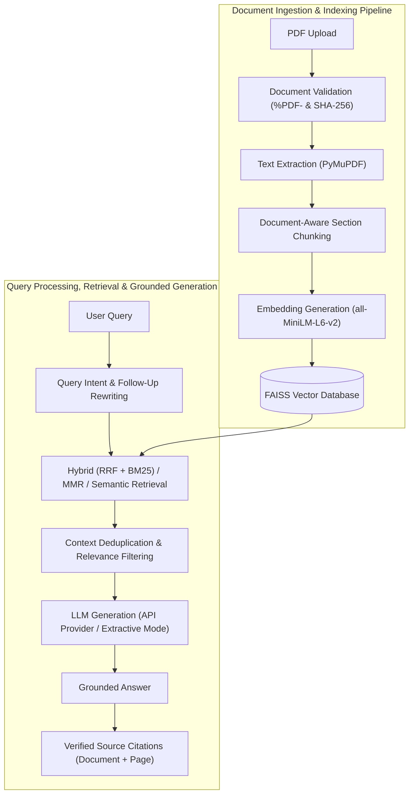
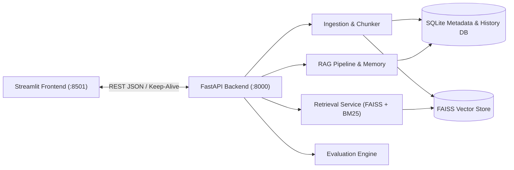
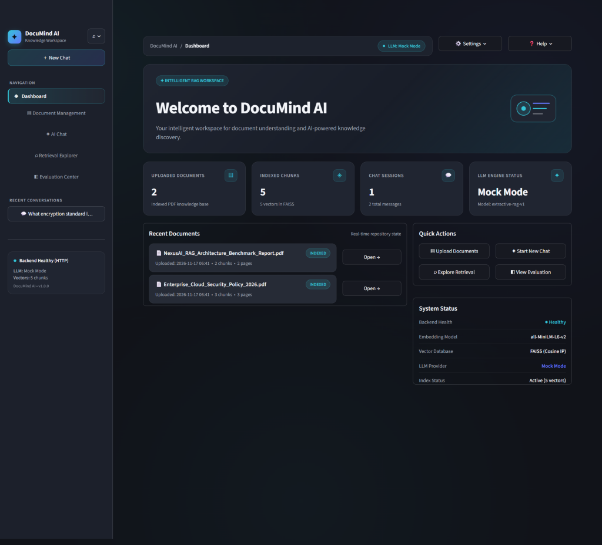
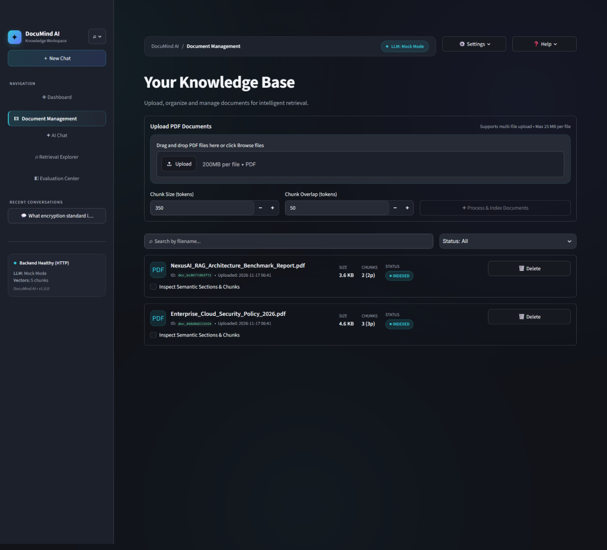
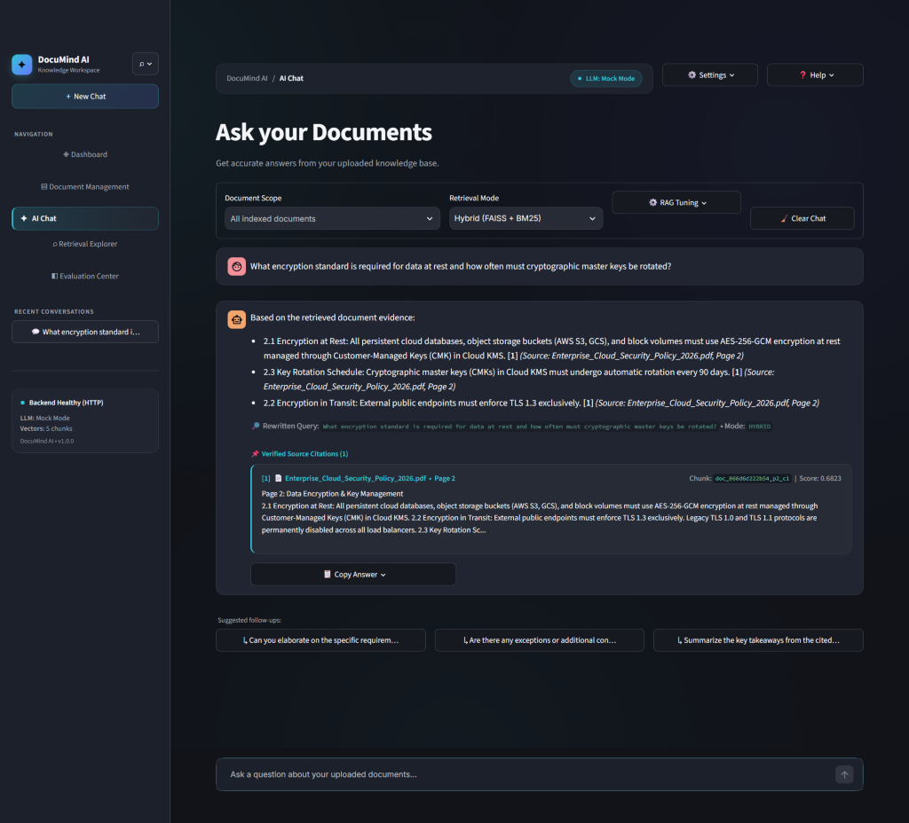
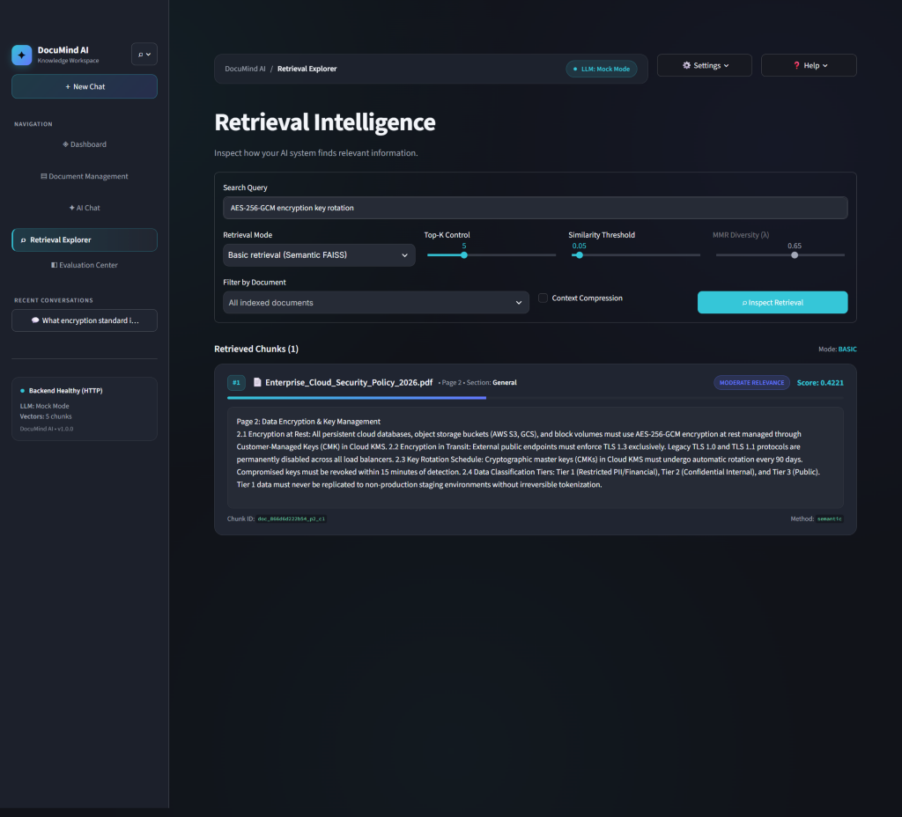
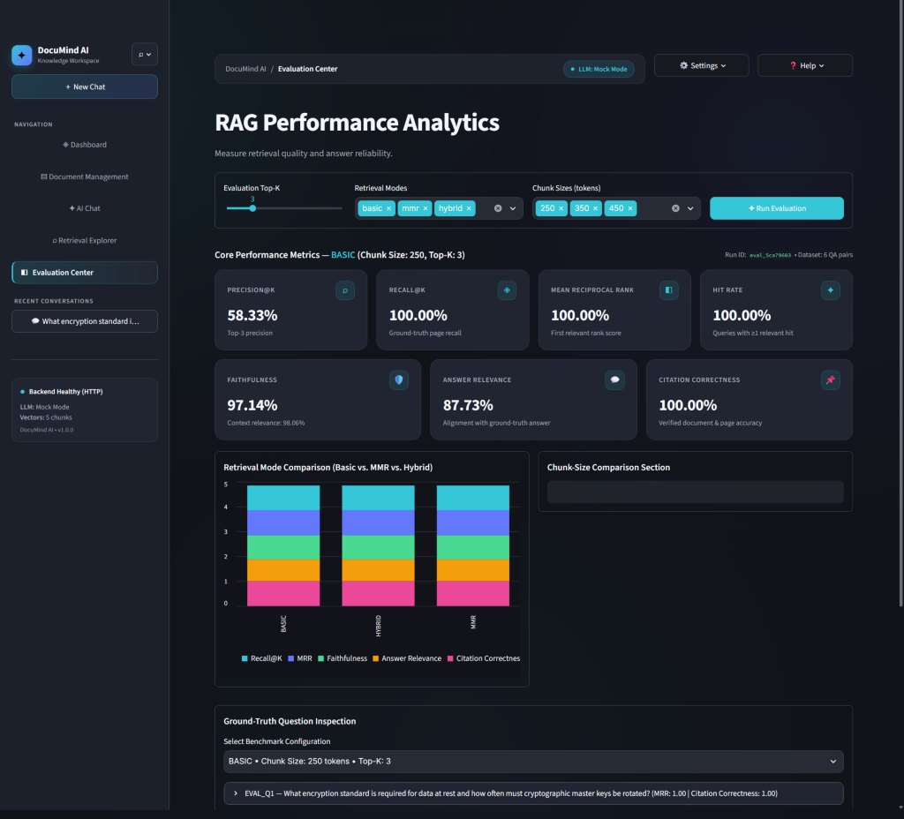

# ✦ DocuMind AI
### Intelligent Document Question Answering System using Retrieval-Augmented Generation (RAG)

[](https://www.python.org/)
[](https://fastapi.tiangolo.com/)
[](https://streamlit.io/)
[](https://www.langchain.com/)
[](https://huggingface.co/sentence-transformers/all-MiniLM-L6-v2)
[](https://github.com/facebookresearch/faiss)
[-2EA043?logo=pytest&logoColor=white)](#m-testing)
[](#n-docker-deployment)
[](LICENSE)

**DocuMind AI** is a modular, production-oriented **Retrieval-Augmented Generation (RAG)** application that allows users to upload multiple PDF documents, index them using semantic section-aware chunking and dense vector embeddings, and receive accurate, evidence-grounded answers backed by verifiable page-level source citations.

---

## B. Project Overview

### What Problem Does DocuMind AI Solve?
Organizations and researchers store critical knowledge across technical documentation, security policies, research papers, and structured reports in PDF format. Traditional keyword search struggles with semantic intent and synonyms, while standalone Large Language Models (LLMs) hallucinate unsupported facts and cannot cite internal documents.

### Why Retrieval-Augmented Generation (RAG)?
DocuMind AI bridges this gap by combining **high-precision information retrieval** with **strictly grounded answer synthesis**:
- Every uploaded PDF is validated, cleaned, segmented by structural section boundaries, and indexed in **FAISS** (dense cosine similarity) and **BM25** (sparse lexical matching).
- User questions are classified by intent, matched against relevant document sections via **Reciprocal Rank Fusion (RRF)** or **Maximum Marginal Relevance (MMR)**, and answered strictly from retrieved evidence with verifiable `[Doc, Page]` citations.
- When the uploaded documents do not contain sufficient evidence to answer a question, the system explicitly states that the information is unavailable rather than inventing facts.

### What Makes This Project Technically Interesting?
- **Document-Aware & Section-Aware Chunking**: Detects structural boundaries across technical reports, research papers, and resumes (`350` tokens / `50` overlap default) rather than slicing mid-sentence or merging unrelated sections.
- **Principled Hybrid Retrieval (RRF + Lucene BM25 + FAISS)**: Fuses dense semantic ranks (`all-MiniLM-L6-v2`) with non-negative Lucene-IDF BM25 lexical ranks via Reciprocal Rank Fusion and query-aware section alignment.
- **Two-Stage Hallucination Guardrails**: Pre-generation evidence verification (`_has_sufficient_evidence`) and post-generation token grounding verification (`compute_grounding_score`) with strict citation validation.
- **Zero-Key Grounded Extractive Mode + Multi-Provider LLM Support**: Works out of the box with no paid API key required (`LLM_PROVIDER="mock"`), and switches seamlessly to **OpenAI**, **Groq**, **OpenRouter**, or **Google Gemini** via environment variables.
- **Reproducible Evaluation Suite**: Built-in benchmarking engine measuring `Precision@K`, `Recall@K`, `MRR`, `Hit Rate`, `Faithfulness`, `Answer Relevance`, `Context Relevance`, and `Citation Correctness` across retrieval modes and chunk sizes.

---

## C. Key Features

| Category | Implemented Capabilities |
| :--- | :--- |
| **Document Intelligence** | Multi-PDF upload, `%PDF-` magic-byte & size validation, PyMuPDF page-level text extraction, semantic section-aware chunking, full metadata preservation (`document_id`, `filename`, `page_number`, `chunk_id`, `section_title`, `document_hash`), and SHA-256 duplicate detection. |
| **Retrieval Engine** | **Basic Semantic Search** (FAISS `IndexFlatIP`), **Hybrid Search** (FAISS + Lucene BM25 via Reciprocal Rank Fusion), **MMR Retrieval** ($\lambda=0.65$ diversity), **Query Rewriting** for conversational follow-ups, **Context Deduplication & Compression**, and **Multi-Document Comparison**. |
| **AI Generation & Memory** | Configurable LLM providers (`openai`, `groq`, `openrouter`, `gemini`, `mock`), strict grounding prompts, insufficient-context refusal, verified page-level `SourceCitation` cards, and isolated multi-session conversational memory in SQLite. |
| **RAG Evaluation** | Automated evaluation pipeline computing **Retrieval Metrics** (`Precision@K`, `Recall@K`, `MRR`, `Hit Rate`) and **Generation Metrics** (`Faithfulness`, `Answer Relevance`, `Context Relevance`, `Citation Correctness`) with multi-chunk-size comparison. |
| **Application & UX** | Decoupled **FastAPI** REST backend with Swagger docs (`/docs`) + modern dark SaaS **Streamlit** frontend (**Dashboard**, **Document Management**, **AI Chat**, **Retrieval Explorer**, **Evaluation Center**) with HTTP keep-alive pooling and `@st.cache_data` invalidation. |

---

## D. Technology Stack

| Technology | Version | Role in DocuMind AI |
| :--- | :--- | :--- |
| **Python** | `3.12+` | Core backend, RAG pipeline, and evaluation runtime |
| **FastAPI & Uvicorn** | `0.115+` | Asynchronous REST API server, OpenAPI docs, and rate-limiting middleware |
| **Streamlit** | `1.39+` | Interactive 5-page dark AI SaaS web dashboard |
| **LangChain & Text Splitters** | `0.3+` | Token-aware recursive text splitting and RAG abstractions |
| **HuggingFace Sentence-Transformers** | `3.1+` | Dense vector embeddings via `sentence-transformers/all-MiniLM-L6-v2` (384-d) |
| **FAISS (`faiss-cpu`)** | `1.8+` | Persistent L2-normalized inner-product (`IndexFlatIP`) cosine vector store |
| **BM25 (`rank-bm25`)** | `0.2.2+` | Sparse lexical keyword scoring with Lucene non-negative IDF |
| **SQLite (`sqlite3`)** | Built-in | Thread-safe relational repository for document metadata, chunks, sessions, and messages |
| **PyMuPDF (`pymupdf`)** | `1.24+` | High-speed page-level PDF text and metadata extraction |
| **Pydantic & Pydantic-Settings** | `2.9+` | Request/response schema validation and environment-driven configuration |
| **Pytest & Pytest-Cov** | `8.3+` | Automated unit, integration, API, and regression testing suite |
| **Docker & Docker Compose** | `24+` | Containerized multi-service orchestration for backend and frontend |

---

## E. System Architecture

### 1. End-to-End Ingestion & RAG Query Flow



### 2. Component Interaction Architecture



---

## F. RAG Pipeline Explanation

1. **Document Ingestion**: Validates uploaded files for `.pdf` extension, MIME type, maximum size (`25 MB`), and `%PDF-` magic header bytes. Computes a SHA-256 hash to prevent duplicate indexing.
2. **PDF Extraction**: Extracts text page-by-page using PyMuPDF while preserving 1-based page numbers, repairing hyphenated line wraps, and neutralizing prompt-injection patterns.
3. **Semantic Section-Aware Chunking**: Detects document structure (technical reports, research papers, resumes, general documents) and segments text along section headings (`350` tokens default, `50` token overlap) while preserving `section_title`, `page_number`, `source_text`, and `document_hash`.
4. **Embedding Generation**: Encodes document chunks into L2-normalized 384-dimensional float32 vectors using `sentence-transformers/all-MiniLM-L6-v2`.
5. **Vector Storage**: Persists vectors and 1-to-1 chunk metadata in a `FAISSVectorStore` (`IndexFlatIP` exact cosine similarity) supporting document-scoped filtering, deletion, and index rebuilding.
6. **Query Embedding & Intent Classification**: Encodes the user's question (rewriting ambiguous follow-up pronouns from session history when needed) and classifies intent (`simple_factual`, `entity_or_section`, or `complex_broad`).
7. **Semantic & MMR Retrieval**: Computes cosine similarity against FAISS vectors, optionally applying Maximum Marginal Relevance ($\lambda = 0.65$) to maximize diversity across chunks.
8. **Hybrid Retrieval (RRF)**: Combines dense FAISS semantic ranks and sparse Lucene-IDF BM25 keyword ranks using **Reciprocal Rank Fusion (RRF)** plus section-alignment scoring over a two-stage candidate pool (`candidate_k = 10` $\rightarrow$ pruned to top relevant chunks).
9. **Context Construction**: Deduplicates chunks via Jaccard similarity, filters low-scoring tail sections, and formats numbered evidence blocks (`--- Citation [1] ---`) with document and page metadata.
10. **LLM Generation**: Passes the structured context and strict system instructions to the configured LLM provider (or the built-in Grounded Extractive Engine in `mock` mode).
11. **Citation & Grounding Verification**: Verifies lexical grounding (`compute_grounding_score`) and maps every citation (`[1]`, `[2]`) strictly to an actual retrieved chunk, document name, and page number.

---

## G. Project Structure

```text
DocuMind-AI/
├── backend/
│   ├── app/
│   │   ├── main.py                  # FastAPI entrypoint, CORS, rate limiting & startup lifespan
│   │   ├── api/                     # Modular REST route controllers & dependency injection
│   │   │   ├── dependencies.py
│   │   │   ├── routes_health.py
│   │   │   ├── routes_documents.py
│   │   │   ├── routes_chat.py
│   │   │   ├── routes_retrieval.py
│   │   │   └── routes_evaluation.py
│   │   ├── core/                    # Environment settings, secret-redacting logger, security
│   │   ├── ingestion/               # PyMuPDF extraction, text cleaning & ingestion pipeline
│   │   ├── chunking/                # Document-aware & section-aware recursive chunker
│   │   ├── embeddings/              # HuggingFace all-MiniLM-L6-v2 embedding service
│   │   ├── vectorstore/             # Abstract VectorStoreBase & FAISSVectorStore
│   │   ├── retrieval/               # Basic, MMR, Hybrid RRF, QueryRewriter & ContextCompressor
│   │   ├── generation/              # Prompts, configurable LLMClient & RAGPipeline
│   │   ├── memory/                  # Isolated multi-session conversation manager
│   │   ├── evaluation/              # Retrieval & generation benchmark engine
│   │   ├── database/                # BaseRepository interface & thread-safe SQLiteRepository
│   │   └── schemas/                 # Pydantic v2 request/response data models
│   └── tests/                       # Pytest unit, integration, API & regression test suite
├── frontend/
│   ├── app.py                       # Streamlit main router & fixed sidebar layout
│   ├── pages/                       # Modular views (Dashboard, Docs, Chat, Retrieval, Eval)
│   ├── components/                  # Custom dark SaaS CSS & reusable UI cards
│   └── utils/                       # Persistent keep-alive API client with @st.cache_data
├── evaluation/
│   ├── datasets/                    # Verified ground-truth QA dataset (eval_dataset.json)
│   └── results/                     # Persisted evaluation benchmark outputs
├── scripts/
│   └── generate_sample_pdfs.py      # Synthetic benchmark PDF & dataset generator
├── docs/
│   ├── architecture.md              # Detailed system architecture notes
│   ├── rag-pipeline.md              # 11-stage RAG pipeline technical reference
│   ├── api-documentation.md         # REST API endpoint reference & examples
│   └── screenshots/                 # Application UI screenshots
├── .github/
│   └── workflows/
│       └── ci.yml                   # GitHub Actions automated test pipeline
├── .streamlit/
│   └── config.toml                  # Streamlit dark theme configuration
├── .env.example                     # Safe environment configuration template
├── .gitignore                       # Git exclusion rules for secrets & runtime data
├── requirements.txt                 # Python package dependencies
├── Dockerfile                       # Container image definition
├── docker-compose.yml               # Multi-container orchestration (backend + frontend)
├── CONTRIBUTING.md                  # Contributor setup & workflow guide
├── LICENSE                          # MIT License
└── README.md
```

---

## H. Installation and Setup

### 1. Clone the Repository
```bash
git clone https://github.com/hnimje14/DocuMind-AI.git
cd DocuMind-AI
```

### 2. Create and Activate a Virtual Environment
- **Windows (PowerShell):**
  ```powershell
  python -m venv .venv
  .\.venv\Scripts\Activate.ps1
  ```
- **Linux / macOS:**
  ```bash
  python3 -m venv .venv
  source .venv/bin/activate
  ```

### 3. Install Dependencies
```bash
pip install -r requirements.txt
```

### 4. Configure Environment Variables
```bash
cp .env.example .env
```

### 5. Start the FastAPI Backend
```bash
uvicorn backend.app.main:app --host 0.0.0.0 --port 8000
```
- Backend Health Check: `http://localhost:8000/health`
- Interactive Swagger API Docs: `http://localhost:8000/docs`

### 6. Start the Streamlit Frontend
In a second terminal:
```bash
streamlit run frontend/app.py --server.port 8501
```
- Open the Web Application at: `http://localhost:8501`

---

## I. Environment Configuration

All settings are controlled via environment variables or `.env` (see [.env.example](.env.example)):

| Variable | Default | Description |
| :--- | :--- | :--- |
| `LLM_PROVIDER` | `"mock"` | `"mock"` (zero-key extractive mode), `"openai"`, `"groq"`, `"openrouter"`, or `"gemini"` |
| `LLM_API_KEY` | `""` | API key for live LLM providers (never hardcode; leave empty for `"mock"` mode) |
| `LLM_BASE_URL` | `""` | Optional custom OpenAI-compatible base URL |
| `LLM_MODEL` | `"gpt-4o-mini"` | Target model identifier (e.g., `"gpt-4o-mini"`, `"llama-3.3-70b-versatile"`) |
| `EMBEDDING_MODEL_NAME` | `"sentence-transformers/all-MiniLM-L6-v2"` | HuggingFace sentence-transformer model |
| `MAX_FILE_SIZE_MB` | `25` | Maximum allowed size per uploaded PDF in megabytes |
| `DEFAULT_CHUNK_SIZE` | `350` | Default target chunk size in tokens |
| `DEFAULT_CHUNK_OVERLAP` | `50` | Default token overlap between consecutive sub-chunks |
| `DEFAULT_TOP_K` | `5` | Default maximum chunks retrieved per query |
| `DEFAULT_SIMILARITY_THRESHOLD` | `0.05` | Minimum similarity threshold required for retrieval |
| `BACKEND_URL` | `"http://127.0.0.1:8000"` | Backend URL used by the Streamlit frontend |

---

## J. API Documentation

Interactive Swagger documentation is served automatically at **`http://localhost:8000/docs`**. Full request/response examples are available in [docs/api-documentation.md](docs/api-documentation.md).

| Method | Endpoint | Purpose |
| :--- | :--- | :--- |
| `GET` | `/health` | System health check, active model configuration, and live document/chunk/session counts |
| `POST` | `/documents/upload` | Multipart upload and indexing of one or more PDF files |
| `GET` | `/documents` | List all uploaded documents and their processing statuses |
| `GET` | `/documents/{document_id}` | Inspect document metadata and all extracted semantic chunks |
| `DELETE` | `/documents/{document_id}` | Delete a document from SQLite, remove its FAISS vectors, and rebuild the index |
| `POST` | `/documents/reindex` | Reprocess indexed documents with updated chunking parameters and rebuild FAISS |
| `POST` | `/chat/ask` | Ask a question grounded in retrieved chunks with session memory and verified citations |
| `GET` | `/chat/sessions` | List all isolated conversation sessions |
| `POST` | `/chat/sessions` | Create a new isolated conversation session |
| `GET` | `/chat/history/{session_id}` | Retrieve full message history and citations for a session |
| `DELETE` | `/chat/history/{session_id}` | Clear and delete a conversation session |
| `POST` | `/retrieval/search` | Standalone Basic, MMR, or Hybrid RRF chunk retrieval explorer |
| `POST` | `/evaluation/run` | Execute reproducible retrieval & generation evaluation benchmarks |
| `GET` | `/evaluation/latest` | Retrieve the latest saved evaluation benchmark report |

---

## K. Application Screenshots

All screenshots below are captured directly from the running **DocuMind AI** application using synthetic technical documents:

### 1. Main Dashboard


### 2. Document Management (Knowledge Base)


### 3. AI Chat with Verified Source Citations


### 4. Retrieval Intelligence Explorer


### 5. Evaluation Center (RAG Performance Analytics)


---

## L. Evaluation Results

Evaluated on the ground-truth benchmark dataset ([evaluation/datasets/eval_dataset.json](evaluation/datasets/eval_dataset.json), **6 multi-page technical & cross-document QA pairs**, `Chunk Size = 350 tokens`, `Top-K = 3`) using `sentence-transformers/all-MiniLM-L6-v2`:

| Metric | Basic (Semantic FAISS) | MMR ($\lambda = 0.65$) | Hybrid (FAISS + BM25 RRF) |
| :--- | :---: | :---: | :---: |
| **Precision@3** | `58.33%` (`0.5833`) | `58.33%` (`0.5833`) | **`63.89%` (`0.6389`)** |
| **Recall@3** | `100.00%` (`1.0000`) | `100.00%` (`1.0000`) | **`100.00%` (`1.0000`)** |
| **Mean Reciprocal Rank (MRR)** | `100.00%` (`1.0000`) | `100.00%` (`1.0000`) | **`100.00%` (`1.0000`)** |
| **Hit Rate** | `100.00%` (`1.0000`) | `100.00%` (`1.0000`) | **`100.00%` (`1.0000`)** |
| **Faithfulness** | `97.14%` (`0.9714`) | `97.14%` (`0.9714`) | **`97.14%` (`0.9714`)** |
| **Answer Relevance** | `87.54%` (`0.8754`) | `87.54%` (`0.8754`) | **`87.54%` (`0.8754`)** |
| **Context Relevance** | `98.11%` (`0.9811`) | `98.11%` (`0.9811`) | **`98.11%` (`0.9811`)** |
| **Citation Correctness** | `100.00%` (`1.0000`) | `100.00%` (`1.0000`) | **`100.00%` (`1.0000`)** |

---

## M. Testing

Run the complete automated test suite using Pytest:

```bash
pytest -v
```

Run with line-by-line coverage reporting:

```bash
pytest --cov=backend.app --cov-report=term-missing
```

### Verified Test Suite (`14 Passed`, `84%` Backend Coverage)
- **Ingestion & Chunking (`test_ingestion_and_chunking.py`)**: Page-level PDF extraction, empty/corrupted PDF error tracking, extension/MIME/magic-byte validation, SHA-256 duplicate prevention, and configurable chunking metadata.
- **Vector Store & Retrieval (`test_vectorstore_and_retrieval.py`)**: L2 embedding normalization, FAISS insertion, document-scoped metadata filtering, MMR, Hybrid RRF+BM25 search, and document deletion/rebuilding.
- **RAG Generation, Citations & Memory (`test_rag_and_memory.py`)**: Grounded answer synthesis, page-level citation verification, insufficient-context refusal on out-of-domain questions, conversational follow-up rewriting, session isolation, and 6-question resume section-level regression tests.
- **REST API & Security (`test_api_endpoints.py`, `test_comprehensive_qa_suite.py`)**: End-to-end verification of all FastAPI endpoints, 7 document upload scenarios (including oversized `> 25 MB` and corrupted streams), prompt-injection blocking, and multi-chunk evaluation runs.

---

## N. Docker Deployment

Build and launch both the FastAPI backend (`:8000`) and Streamlit frontend (`:8501`) using Docker Compose:

```bash
docker compose up --build
```

- **Streamlit UI:** `http://localhost:8501`
- **FastAPI Backend:** `http://localhost:8000/docs`

---

## O. Limitations

- **Scanned Image-Only PDFs**: `PDFExtractor` extracts embedded digital text via PyMuPDF; scanned image-only PDFs without an OCR text layer are rejected gracefully with an explanatory error message (`status="failed"`).
- **Single-Node FAISS Storage**: `FAISSVectorStore` persists vectors to local disk and memory (`IndexFlatIP`), which is ideal for single-node deployments up to ~500k chunks but does not provide distributed multi-node sharding out of the box.
- **Document Structure Sensitivity**: While semantic section-aware chunking handles standard headings across technical reports, research papers, and resumes, highly irregular multi-column PDF layouts may group adjacent visual columns together.
- **LLM Provider Dependency for Abstractive Synthesis**: The built-in `mock` mode provides zero-cost, 100% grounded extractive synthesis; rich abstractive paraphrasing requires configuring an API key (`OPENAI`, `GROQ`, `OPENROUTER`, or `GEMINI`).

---

## P. Future Improvements

- **OCR Pipeline Integration**: Add RapidOCR / Tesseract fallback for scanned image-only PDFs.
- **Cross-Encoder Reranking**: Integrate `cross-encoder/ms-marco-MiniLM-L-6-v2` as a second-stage neural reranker over the top-10 RRF candidates.
- **PostgreSQL & Distributed Vector Backends**: Add `PostgreSQLRepository` (`asyncpg`) and `QdrantVectorStore` / `ChromaVectorStore` implementations of the existing storage interfaces.
- **Authentication & Multi-Tenant Workspaces**: Add OAuth2/JWT user authentication for per-user document isolation.

---

## Q. License and Contribution

- **License**: Distributed under the **MIT License**. See [LICENSE](LICENSE) for full license text.
- **Contributing**: Contributions, bug reports, and feature enhancements are welcome! Please read [CONTRIBUTING.md](CONTRIBUTING.md) before opening a pull request.
