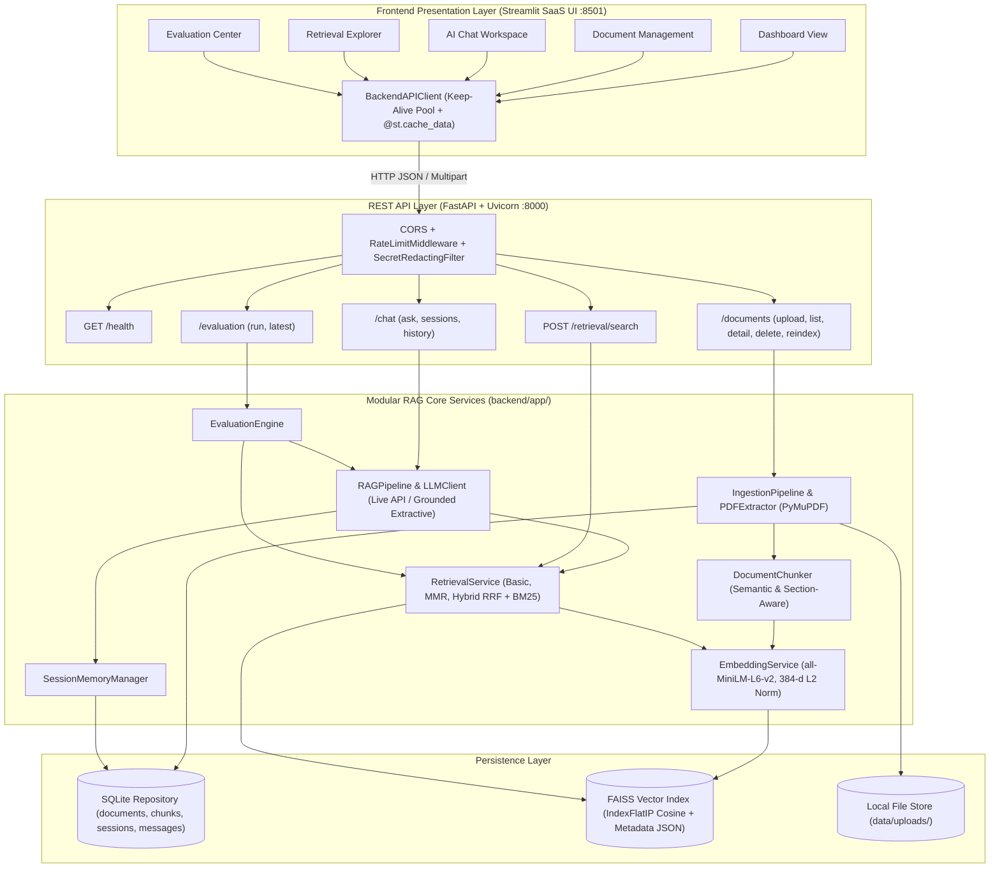

# System Architecture — DocuMind AI

**DocuMind AI** is designed as a decoupled, multi-layered Retrieval-Augmented Generation (RAG) system consisting of a **FastAPI REST Backend**, a **Modular RAG & Storage Core**, an **Automated Evaluation Engine**, and a **Streamlit AI SaaS Frontend**.

---

## 1. High-Level System Architecture

---

## 2. Architectural Design Principles

1. **Strict Separation of Concerns**:
   - **API Controllers (`backend/app/api/`)** handle HTTP status codes, multipart parsing, and Pydantic request/response serialization without embedding business logic.
   - **Domain Services (`ingestion`, `chunking`, `embeddings`, `vectorstore`, `retrieval`, `generation`, `memory`, `evaluation`)** are independently testable and wired via `ServiceContainer` (`backend/app/api/dependencies.py`).
2. **Swappable Storage Interfaces**:
   - `BaseRepository` (`backend/app/database/db.py`) abstracts relational persistence so `SQLiteRepository` can be swapped for PostgreSQL without modifying upstream pipelines.
   - `VectorStoreBase` (`backend/app/vectorstore/base.py`) abstracts vector indexing so `FAISSVectorStore` can be extended with ChromaDB or Qdrant.
3. **Defense-in-Depth Security**:
   - Uploaded files undergo extension, MIME type, file size (`MAX_FILE_SIZE_MB`), and `%PDF-` magic-header validation before parsing.
   - Untrusted document text is sanitized against prompt-injection directives (`sanitize_untrusted_document_text`) and isolated inside `<RETRIEVED_DOCUMENT_CONTEXT>` XML tags.
   - API logs pass through `SecretRedactingFilter` to prevent accidental credential exposure.
