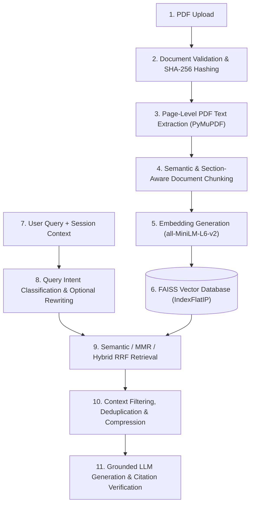

# RAG Pipeline Deep Dive — DocuMind AI

This document explains each of the 11 stages in the **DocuMind AI** Retrieval-Augmented Generation pipeline.

---

## End-to-End Pipeline Flow

---

## Stage-by-Stage Technical Breakdown

### 1. Document Ingestion & Validation (`backend/app/core/security.py`, `backend/app/ingestion/pipeline.py`)
- Validates `.pdf` file extension, MIME type, maximum byte size (`25 MB` default), and `%PDF-` magic header bytes.
- Computes a SHA-256 content hash (`compute_sha256`). If an identical document is already indexed in SQLite, ingestion returns `status="duplicate"` and reuses the existing embeddings.

### 2. PDF Extraction & Text Cleaning (`backend/app/ingestion/extractor.py`)
- Uses **PyMuPDF (`pymupdf`)** to extract text page by page while preserving 1-based page numbers and document metadata.
- Repairs hyphenated line-break splits, normalizes whitespace, preserves structural section headers and `Key: Value` pairs, and neutralizes embedded prompt-injection strings.

### 3. Semantic & Document-Aware Chunking (`backend/app/chunking/chunker.py`)
- Classifies document structure (`resume`, `research`, or `general`) via `detect_document_type()`.
- Segments pages along semantic section boundaries (`Personal Information`, `Academic Details`, `Technical Proficiency`, individual `Projects`, `Internships`, `Certifications` for resumes; `Abstract`, `Introduction`, `Methodology`, `Results`, `Conclusion`, `References`, and numbered headings for technical reports).
- Splits sections exceeding `DEFAULT_CHUNK_SIZE` (`350` tokens, `50` token overlap) using `RecursiveCharacterTextSplitter` while preserving `document_id`, `filename`, `page_number`, `chunk_id`, `chunk_index`, `section_title`, `source_text`, and `document_hash`.

### 4. Embedding Generation (`backend/app/embeddings/embedder.py`)
- Encodes chunk texts and user queries into 384-dimensional vectors using `sentence-transformers/all-MiniLM-L6-v2`.
- Applies L2 normalization ($\|\mathbf{v}\|_2 = 1$) so inner-product search in FAISS computes exact cosine similarity.
- Resolves local cached HuggingFace snapshots directly and caches query embeddings in memory.

### 5. Vector Storage (`backend/app/vectorstore/faiss_store.py`)
- Stores normalized vectors in a `faiss.IndexFlatIP` index persisted to `data/vectorstore/faiss_index.bin` alongside `faiss_metadata.json`.
- Supports metadata filtering by `document_ids`, document deletion, and full index rebuilding.

### 6. Query Processing & Conversational Rewriting (`backend/app/retrieval/retriever.py`)
- Classifies query intent into `simple_factual`, `entity_or_section`, or `complex_broad` and identifies target section affinity (`classify_query_intent`).
- `QueryRewriter` expands ambiguous follow-up pronouns (`it`, `they`, `that`) using recent session history only when needed, avoiding unnecessary rewriting on standalone questions.

### 7. Semantic, MMR, and Hybrid RRF Retrieval (`backend/app/retrieval/retriever.py`)
- **Basic Mode**: Cosine similarity search over FAISS with section-alignment bonus and candidate pool pruning.
- **MMR Mode**: Maximum Marginal Relevance ($\lambda = 0.65$) balancing query relevance against inter-chunk redundancy.
- **Hybrid Mode**: Combines dense FAISS semantic ranks and sparse **Lucene-IDF BM25 (`BM25Okapi`)** lexical ranks via **Reciprocal Rank Fusion (RRF)** plus query-term coverage and section alignment.

### 8. Context Filtering & Compression (`ContextCompressor`)
- Removes near-duplicate chunks (Jaccard token similarity $\ge 0.80$).
- Applies dynamic relevance cutoffs so simple factual queries retrieve only the 1–2 relevant section chunks rather than padding context with unrelated sections.
- Filters sentences inside long chunks to retain supporting evidence within a token budget.

### 9. Grounded LLM Generation & Citation Verification (`backend/app/generation/rag_pipeline.py`, `llm_client.py`)
- Pre-generation check (`_has_sufficient_evidence`) verifies that retrieved chunks contain evidence supporting the query; otherwise returns an explicit insufficient-context message.
- Supports live OpenAI-compatible LLM providers (`openai`, `groq`, `openrouter`, `gemini`) and a zero-key **Grounded Extractive Mode (`mock`)**.
- Post-generation check (`compute_grounding_score` & `build_verified_citations`) verifies token grounding and ensures every `SourceCitation` (`[1]`, `[2]`) maps strictly to an actual retrieved chunk, document name, and page number.
